# League of Legends

## Total time spent playing League of Legends

This includes all LoL accounts per user.

|  
User                                                                                                                                                                                                                                                                                                                                          |  
Time |
| :------------------------------------------------------------------------------------------------------------------------------------------------------------------------------------------------------------------------------------------------------------------------------------------------------------------------------------------------------------------------------------ | -------------------------------------------: |
| <a href="https://github.com/JoyBoy-IA"><a>&ensp;</a>[JoyBoy-IA](https://github.com/JoyBoy-IA)<a>&ensp;</a><a href="https://github.com/JoyBoy-IA">                             |                             23 days, 7:28:22 |
| <a href="https://github.com/MiniX16"><a>&ensp;</a>[MiniX16](https://github.com/MiniX16)<a>&ensp;</a><a href="https://github.com/MiniX16">                                       |                            13 days, 19:54:15 |
| <a href="https://github.com/lcuasMr"><a>&ensp;</a>[lcuasMr](https://github.com/lcuasMr)<a>&ensp;</a><a href="https://github.com/lcuasMr">                                       |                            11 days, 10:28:55 |
| <a href="https://github.com/CarlosCarballido"><a>&ensp;</a>[CarlosCarballido](https://github.com/CarlosCarballido)<a>&ensp;</a><a href="https://github.com/CarlosCarballido"> |                             6 days, 16:21:58 |
| <a href="https://github.com/susoferreira"><a>&ensp;</a>[susoferreira](https://github.com/susoferreira)<a>&ensp;</a><a href="https://github.com/susoferreira">                   |                              4 days, 0:12:11 |
| <a href="https://github.com/Ventupentu"><a>&ensp;</a>[Ventupentu](https://github.com/Ventupentu)<a>&ensp;</a><a href="https://github.com/Ventupentu">                         |                              3 days, 5:37:05 |
| <a href="https://github.com/FuzzyVee"><a>&ensp;</a>[FuzzyVee](https://github.com/FuzzyVee)<a>&ensp;</a><a href="https://github.com/FuzzyVee">                                 |                              3 days, 5:33:04 |
| <a href="https://github.com/Icey-the-dragon"><a>&ensp;</a>[Icey-the-dragon](https://github.com/Icey-the-dragon)<a>&ensp;</a><a href="https://github.com/Icey-the-dragon">       |                             2 days, 22:52:35 |
| <a href="https://github.com/AlexFM9"><a>&ensp;</a>[AlexFM9](https://github.com/AlexFM9)<a>&ensp;</a><a href="https://github.com/AlexFM9">                                     |                              2 days, 0:47:19 |
| <a href="https://github.com/tomasrial46"><a>&ensp;</a>[tomasrial46](https://github.com/tomasrial46)<a>&ensp;</a><a href="https://github.com/tomasrial46">                     |                              1 day, 20:22:05 |
| <a href="https://github.com/pablotavares05"><a>&ensp;</a>[pablotavares05](https://github.com/pablotavares05)<a>&ensp;</a><a href="https://github.com/pablotavares05">         |                              1 day, 15:12:32 |
| <a href="https://github.com/Meiporu"><a>&ensp;</a>[Meiporu](https://github.com/Meiporu)<a>&ensp;</a><a href="https://github.com/Meiporu">                                     |                               1 day, 8:09:25 |
| <a href="https://github.com/santipvz"><a>&ensp;</a>[santipvz](https://github.com/santipvz)<a>&ensp;</a><a href="https://github.com/santipvz">                                 |                                      0:00:00 |
| Total                                                                                                                                                                                                                                                                                                                                                                                 |                            75 days, 12:59:46 |

## Time by week

|  
Start |  
End |  
Time |
| :-------------------------------------------- | :-----------------------------------------: | -------------------------------------------: |
| 1 April 2026                                  |                8 April 2026                 |                              4 days, 5:26:23 |
| 22 September 2026                             |              29 September 2026              |                              4 days, 0:18:01 |
| 8 April 2026                                  |                15 April 2026                |                             3 days, 22:12:53 |
| 27 May 2026                                   |                 3 June 2026                 |                             3 days, 15:08:21 |
| 13 May 2026                                   |                 20 May 2026                 |                              3 days, 8:57:41 |
| 15 September 2026                             |              22 September 2026              |                              3 days, 6:53:01 |
| 17 June 2026                                  |                24 June 2026                 |                              3 days, 6:12:12 |
| 29 September 2026                             |               6 October 2026                |                              3 days, 1:28:33 |
| 24 June 2026                                  |                 1 July 2026                 |                              3 days, 1:03:20 |
| 10 June 2026                                  |                17 June 2026                 |                             2 days, 22:30:30 |
| 3 June 2026                                   |                10 June 2026                 |                             2 days, 17:01:58 |
| 13 October 2026                               |               20 October 2026               |                             2 days, 14:50:23 |
| 20 May 2026                                   |                 27 May 2026                 |                             2 days, 12:57:44 |
| 29 July 2026                                  |                5 August 2026                |                             2 days, 12:52:14 |
| 29 April 2026                                 |                 6 May 2026                  |                             2 days, 10:51:19 |
| 15 April 2026                                 |                22 April 2026                |                              2 days, 9:18:07 |
| 6 May 2026                                    |                 13 May 2026                 |                              2 days, 8:32:55 |
| 22 July 2026                                  |                29 July 2026                 |                              2 days, 6:57:26 |
| 6 October 2026                                |               13 October 2026               |                              2 days, 5:53:37 |
| 12 August 2026                                |               19 August 2026                |                              2 days, 4:03:24 |
| 8 September 2026                              |              15 September 2026              |                              2 days, 3:50:50 |
| 22 April 2026                                 |                29 April 2026                |                              2 days, 1:46:38 |
| 19 August 2026                                |               26 August 2026                |                              2 days, 1:42:55 |
| 26 August 2026                                |              2 September 2026               |                              1 day, 23:36:48 |
| 2 September 2026                              |              8 September 2026               |                              1 day, 21:37:07 |
| 1 July 2026                                   |                 8 July 2026                 |                              1 day, 19:29:23 |
| 5 August 2026                                 |               12 August 2026                |                              1 day, 17:24:14 |
| 8 July 2026                                   |                15 July 2026                 |                              1 day, 10:51:54 |
| 15 July 2026                                  |                22 July 2026                 |                                     21:08:55 |
| 20 October 2026                               |               27 October 2026               |                                     10:01:00 |

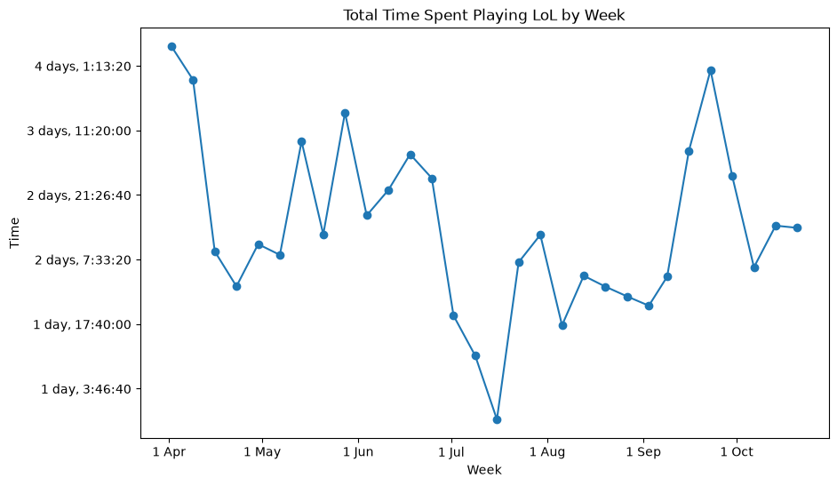

## Clean Time without League of Legends

Current time is the time since the last recorded match, and maximum time is the longest time in between ending a match and starting the next one.

|  
User                                                                                                                                                                                                                                                                                                                                          |  
Maximum |  
Current |
| :------------------------------------------------------------------------------------------------------------------------------------------------------------------------------------------------------------------------------------------------------------------------------------------------------------------------------------------------------------------------------------ | :---------------------------------------------: | ----------------------------------------------: |
| <a href="https://github.com/Ventupentu"><a>&ensp;</a>[Ventupentu](https://github.com/Ventupentu)<a>&ensp;</a><a href="https://github.com/Ventupentu">                         |                11 days, 12:29:36                |                               105 days, 4:52:06 |
| <a href="https://github.com/tomasrial46"><a>&ensp;</a>[tomasrial46](https://github.com/tomasrial46)<a>&ensp;</a><a href="https://github.com/tomasrial46">                     |                32 days, 3:54:31                 |                               47 days, 20:45:53 |
| <a href="https://github.com/CarlosCarballido"><a>&ensp;</a>[CarlosCarballido](https://github.com/CarlosCarballido)<a>&ensp;</a><a href="https://github.com/CarlosCarballido"> |                27 days, 1:20:55                 |                               31 days, 21:40:36 |
| <a href="https://github.com/lcuasMr"><a>&ensp;</a>[lcuasMr](https://github.com/lcuasMr)<a>&ensp;</a><a href="https://github.com/lcuasMr">                                       |                11 days, 14:08:46                |                                15 days, 2:23:47 |
| <a href="https://github.com/susoferreira"><a>&ensp;</a>[susoferreira](https://github.com/susoferreira)<a>&ensp;</a><a href="https://github.com/susoferreira">                   |                40 days, 19:44:44                |                                12 days, 5:13:22 |
| <a href="https://github.com/Icey-the-dragon"><a>&ensp;</a>[Icey-the-dragon](https://github.com/Icey-the-dragon)<a>&ensp;</a><a href="https://github.com/Icey-the-dragon">       |                18 days, 0:54:47                 |                                11 days, 0:38:26 |
| <a href="https://github.com/AlexFM9"><a>&ensp;</a>[AlexFM9](https://github.com/AlexFM9)<a>&ensp;</a><a href="https://github.com/AlexFM9">                                     |                7 days, 18:51:50                 |                                 3 days, 4:31:42 |
| <a href="https://github.com/Meiporu"><a>&ensp;</a>[Meiporu](https://github.com/Meiporu)<a>&ensp;</a><a href="https://github.com/Meiporu">                                     |                104 days, 2:28:23                |                                2 days, 20:33:08 |
| <a href="https://github.com/FuzzyVee"><a>&ensp;</a>[FuzzyVee](https://github.com/FuzzyVee)<a>&ensp;</a><a href="https://github.com/FuzzyVee">                                 |                15 days, 0:16:06                 |                                2 days, 19:06:28 |
| <a href="https://github.com/pablotavares05"><a>&ensp;</a>[pablotavares05](https://github.com/pablotavares05)<a>&ensp;</a><a href="https://github.com/pablotavares05">         |                8 days, 23:25:29                 |                                        21:38:01 |
| <a href="https://github.com/JoyBoy-IA"><a>&ensp;</a>[JoyBoy-IA](https://github.com/JoyBoy-IA)<a>&ensp;</a><a href="https://github.com/JoyBoy-IA">                             |                12 days, 11:11:04                |                                         4:16:50 |
| <a href="https://github.com/MiniX16"><a>&ensp;</a>[MiniX16](https://github.com/MiniX16)<a>&ensp;</a><a href="https://github.com/MiniX16">                                       |                17 days, 16:28:05                |                                         2:58:33 |
| <a href="https://github.com/santipvz"><a>&ensp;</a>[santipvz](https://github.com/santipvz)<a>&ensp;</a><a href="https://github.com/santipvz">                                 |                     0:00:00                     |                                         0:00:00 |

## Weekly Time by Profile

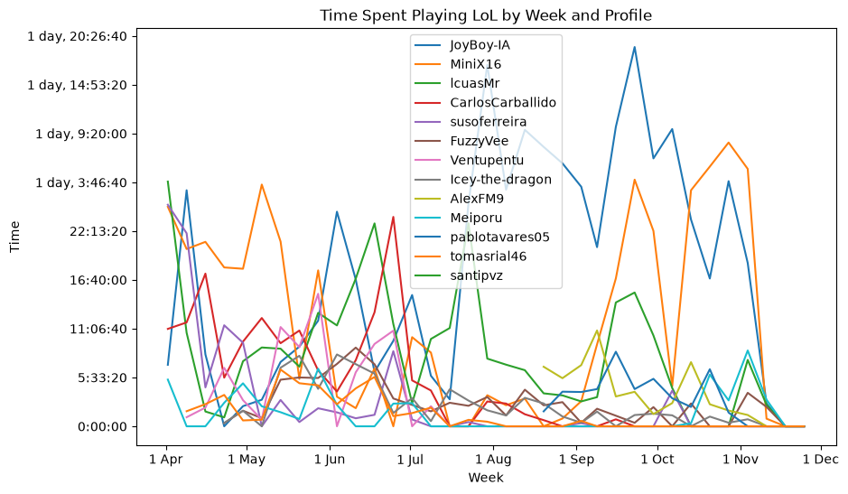

## <a href="https://github.com/JoyBoy-IA"><a>&ensp;</a>[JoyBoy-IA](https://github.com/JoyBoy-IA)<a>&ensp;</a><a href="https://github.com/JoyBoy-IA">

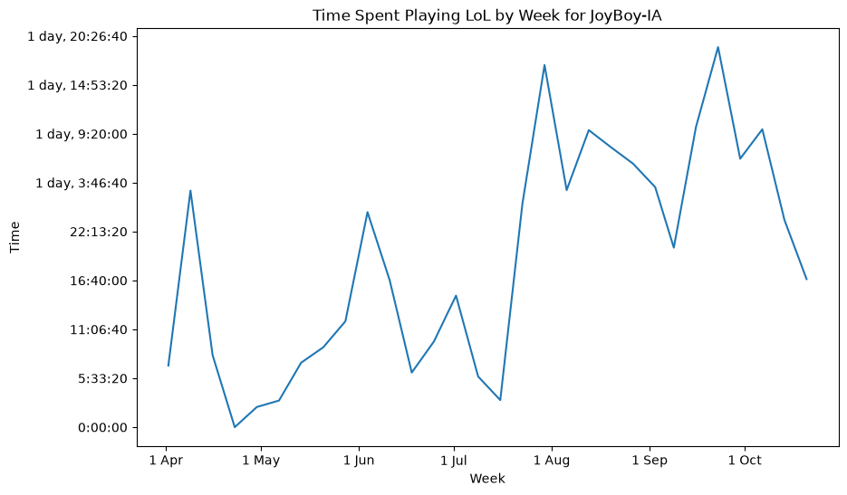

## <a href="https://github.com/MiniX16"><a>&ensp;</a>[MiniX16](https://github.com/MiniX16)<a>&ensp;</a><a href="https://github.com/MiniX16">

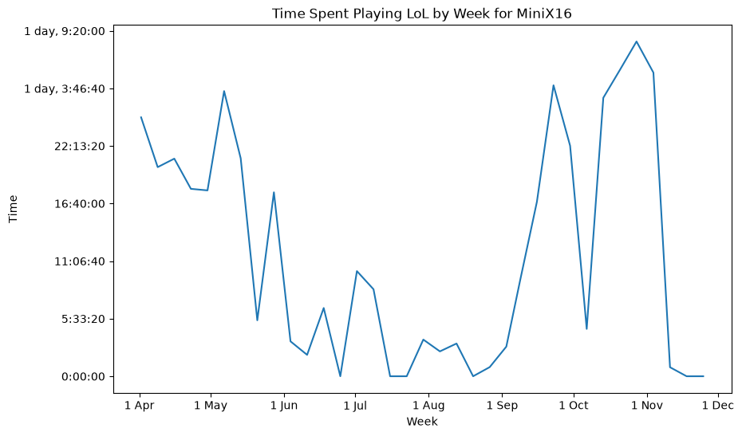

## <a href="https://github.com/lcuasMr"><a>&ensp;</a>[lcuasMr](https://github.com/lcuasMr)<a>&ensp;</a><a href="https://github.com/lcuasMr">

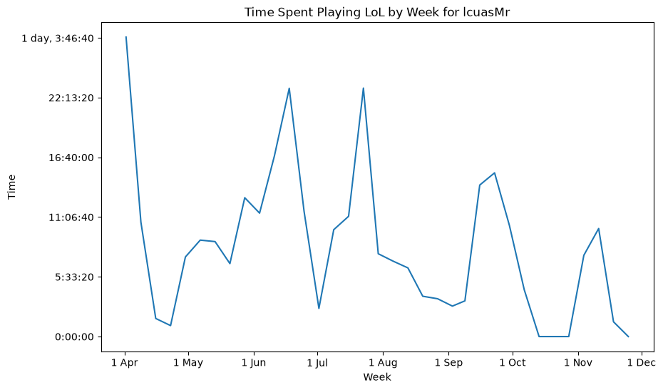

## <a href="https://github.com/CarlosCarballido"><a>&ensp;</a>[CarlosCarballido](https://github.com/CarlosCarballido)<a>&ensp;</a><a href="https://github.com/CarlosCarballido">

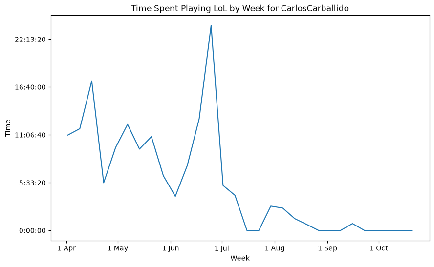

## <a href="https://github.com/susoferreira"><a>&ensp;</a>[susoferreira](https://github.com/susoferreira)<a>&ensp;</a><a href="https://github.com/susoferreira">

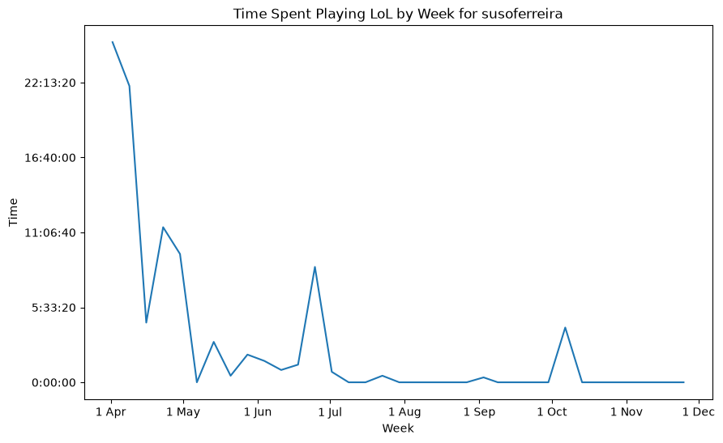

## <a href="https://github.com/Ventupentu"><a>&ensp;</a>[Ventupentu](https://github.com/Ventupentu)<a>&ensp;</a><a href="https://github.com/Ventupentu">

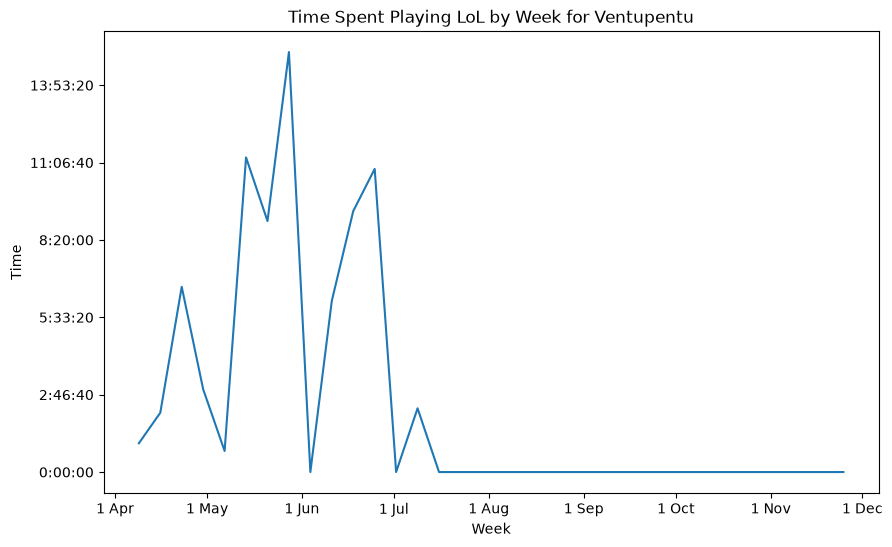

## <a href="https://github.com/FuzzyVee"><a>&ensp;</a>[FuzzyVee](https://github.com/FuzzyVee)<a>&ensp;</a><a href="https://github.com/FuzzyVee">

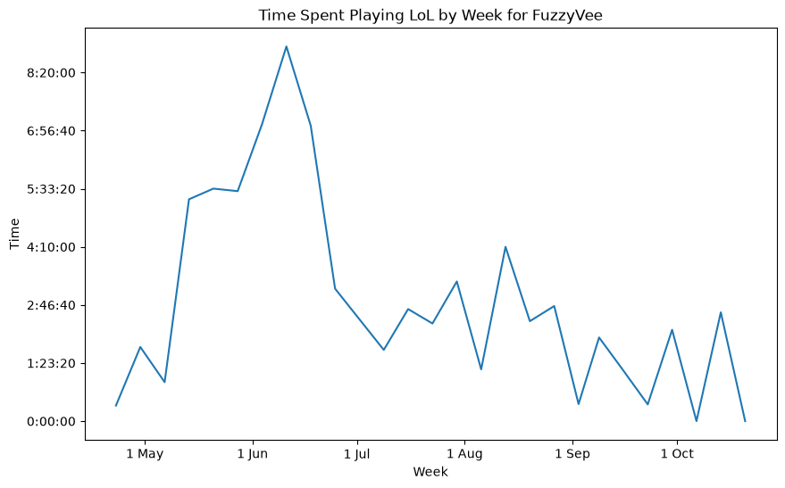

## <a href="https://github.com/Icey-the-dragon"><a>&ensp;</a>[Icey-the-dragon](https://github.com/Icey-the-dragon)<a>&ensp;</a><a href="https://github.com/Icey-the-dragon">

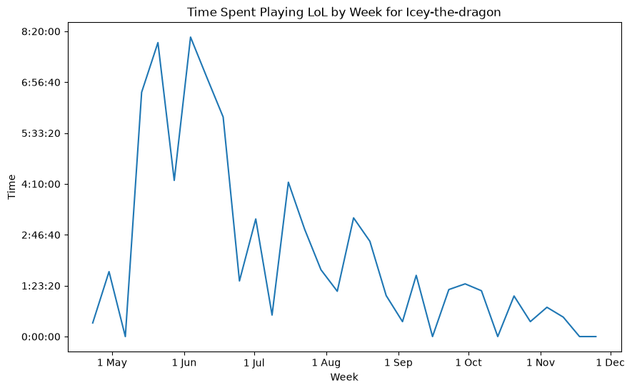

## <a href="https://github.com/AlexFM9"><a>&ensp;</a>[AlexFM9](https://github.com/AlexFM9)<a>&ensp;</a><a href="https://github.com/AlexFM9">

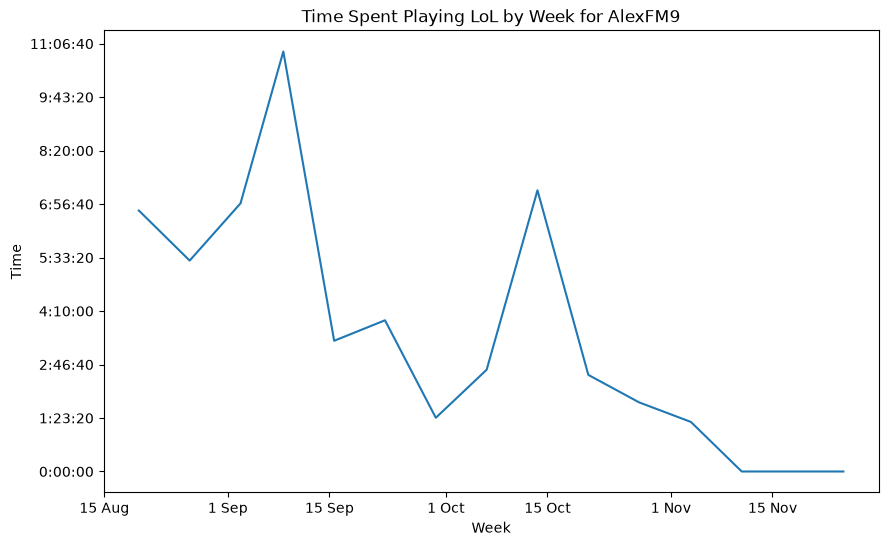

## <a href="https://github.com/tomasrial46"><a>&ensp;</a>[tomasrial46](https://github.com/tomasrial46)<a>&ensp;</a><a href="https://github.com/tomasrial46">

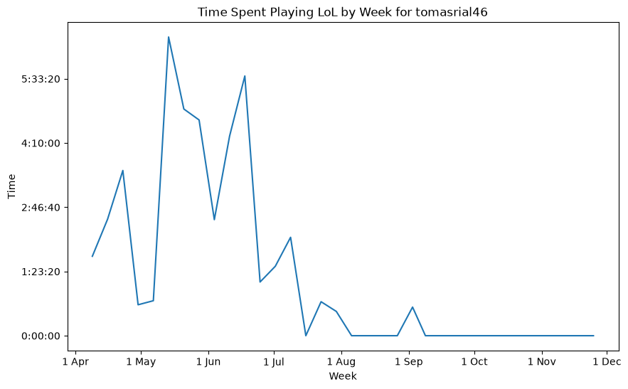

## <a href="https://github.com/pablotavares05"><a>&ensp;</a>[pablotavares05](https://github.com/pablotavares05)<a>&ensp;</a><a href="https://github.com/pablotavares05">

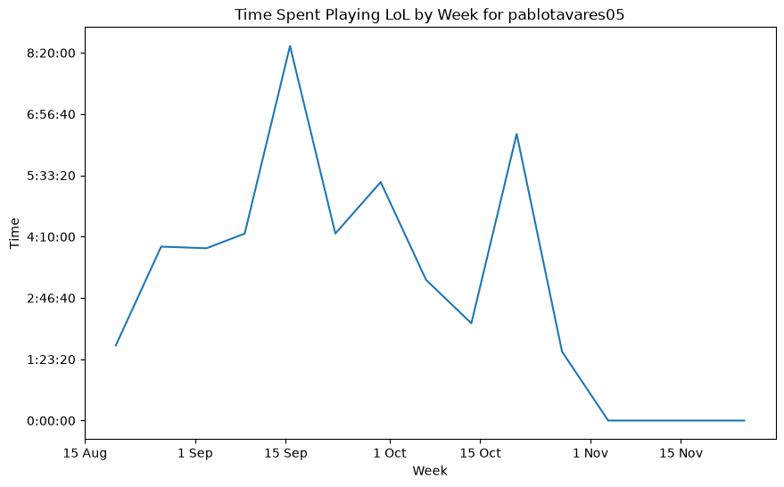

## <a href="https://github.com/Meiporu"><a>&ensp;</a>[Meiporu](https://github.com/Meiporu)<a>&ensp;</a><a href="https://github.com/Meiporu">

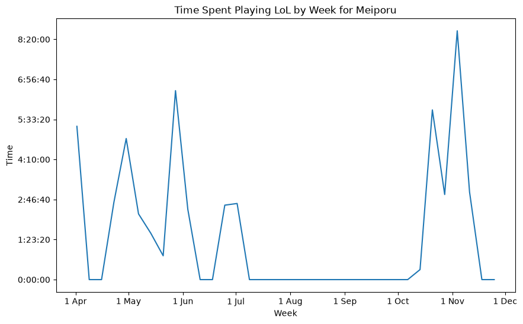

## <a href="https://github.com/santipvz"><a>&ensp;</a>[santipvz](https://github.com/santipvz)<a>&ensp;</a><a href="https://github.com/santipvz">

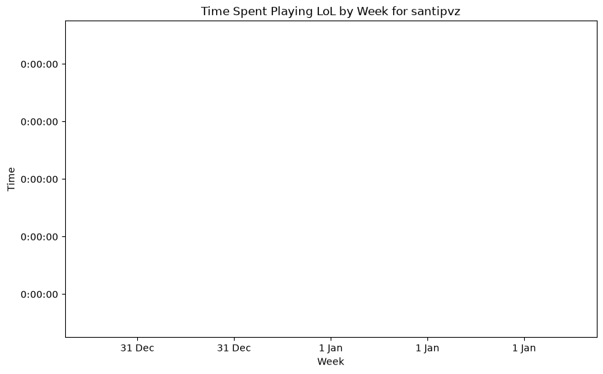
